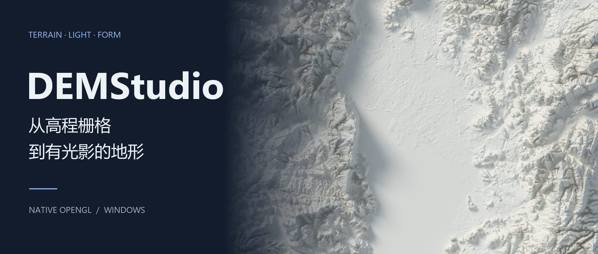

<p align="center">
  
</p>

# DEMStudio

**从高程栅格，到有光影的地形。**

面向地形可视化的 Windows 桌面工具。导入高度图，调整曲面、外观与光照，导出 PNG 或保留地理参考的正射 GeoTIFF。

`Windows` · `Rust` · `Tauri 2` · `OpenGL` · `0.0.1`

## 塑造地形的每一层

| 地形 | 外观 | 光影 | 输出 |
| --- | --- | --- | --- |
| 方块、多边形、双线性、双三次曲面 | 统一材质、高程色带、图像贴图 | 太阳、天空、渐进采样 | 当前视图、原图正射 |
| 高度缩放与偏移 | 连续 / 离散色带、自定义颜色 | 软阴影、曝光与整体调色 | PNG 倍率 / 自定义尺寸、GeoTIFF |

浮动面板围绕地形视口展开；Rust 原生核心负责 GPU 渲染，Tauri 界面负责参数与交互。导出使用固定场景快照，预览缩放保持输出构图。

## 从源码运行

准备 Windows、Rust MSVC 工具链、Visual Studio C++ 构建工具、WebView2 Runtime，以及支持 OpenGL 3.3 compatibility 的显卡驱动。前端为原生 HTML / CSS / JavaScript，无 npm 构建步骤。

```powershell
git clone https://github.com/SpDDoggy/DEMStudio.git
cd DEMStudio
cargo run --release --locked --manifest-path src-tauri/Cargo.toml
```

首次构建会下载 Cargo 依赖。只构建程序：

```powershell
cargo build --release --locked --manifest-path src-tauri/Cargo.toml
```

生成文件：`src-tauri/target/release/demstudio.exe`。

## 操作

1. 导入 PNG、JPEG、TIFF / BigTIFF 或 ASC 高度栅格。
2. 设置曲面、高度、材质 / 赋色 / 贴图与光照。
3. 右键拖动旋转，Shift + 右键拖动平移，滚轮缩放；方向立方体切换视角。
4. 打开导出，选择 PNG 当前视图 / 原图正射，或 GeoTIFF 正射输出。

GeoTIFF 沿用源像元网格与地理参考，可选透明阴影外扩。大栅格使用有界预览几何；输出像素尺寸与预览几何精度分别控制。

## 代码结构

```text
src/ui/                         界面、参数与相机交互
src-tauri/src/main.rs            桌面入口与 IPC
src-tauri/src/renderer/          原生视口、渲染、栅格读写与导出
src-tauri/src/renderer/shaders/  内嵌 GLSL
src-tauri/icons/                 应用图标
```

当前后端为 OpenGL，运行平台为 Windows。
